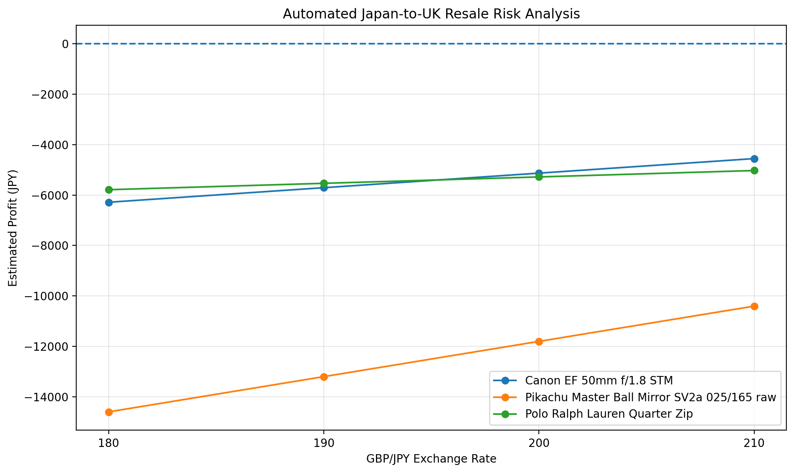
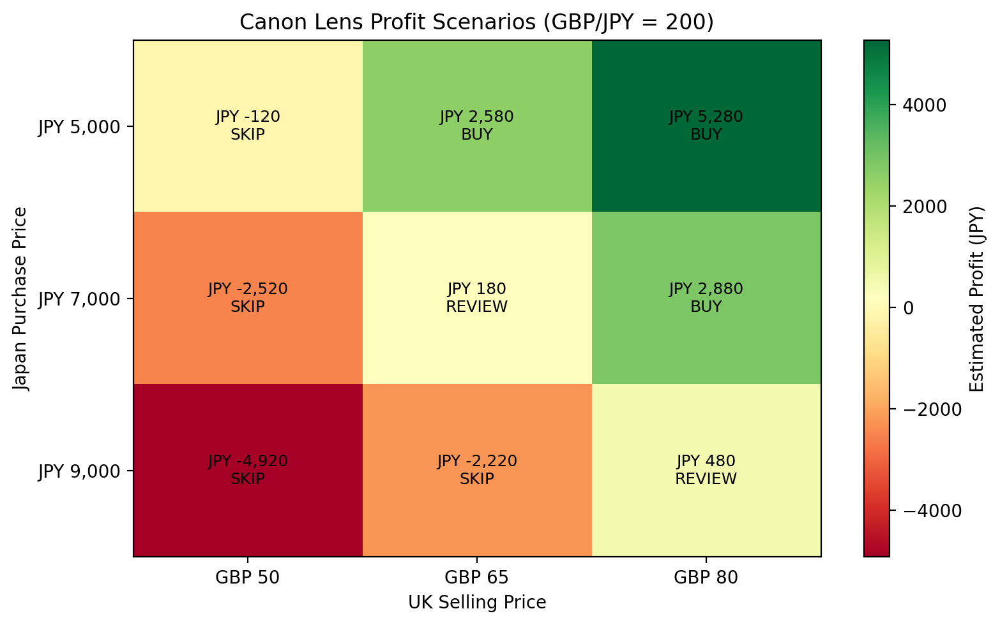

# Japan-to-UK Resale Profitability Analytics

**Business Analytics Portfolio Project | Python · SQLite · Matplotlib**

## Executive Summary

This project evaluates the financial feasibility of purchasing secondhand products in Japan and reselling them in the United Kingdom.

I developed a data-driven decision framework that combines marketplace price observations, profitability modeling, foreign-exchange sensitivity analysis, and scenario analysis.

**Key finding:** Under the modeled cost assumptions, purchasing the three directly compared products at their observed average Japanese prices would result in estimated losses. However, selected Canon lens scenarios become profitable when acquisition costs are sufficiently low.

## Business Problem

Cross-border resale businesses must account for multiple sources of uncertainty, including acquisition prices, resale demand, currency fluctuations, marketplace fees, shipping expenses, and import costs.

This project addresses three questions:

1. Which products offer potentially profitable resale opportunities?
2. How sensitive are margins to foreign-exchange rates and import costs?
3. What acquisition and resale prices are required to achieve a target profit?

## Data and Tools

The project uses marketplace price observations from Japanese and UK resale platforms, organized into a relational SQLite database.

The database contains 34 product records and 27 marketplace observation records. Some observations are aggregated averages rather than individual listings.

**Technologies used:**

- **Python:** Profitability calculations and scenario modeling
- **SQLite / SQL:** Structured data storage and querying
- **Matplotlib:** Data visualization
- **CSV:** Source data and analytical outputs

The project covers used camera lenses, trading cards, clothing, and smartphones.

The primary automated analysis focuses on a Canon EF 50mm lens, a Pikachu trading card, and a Polo Ralph Lauren quarter-zip. The iPhone comparison remains preliminary because product-condition details are not directly comparable across markets.

## Methodology

### 1. Marketplace Price Analysis

Japanese acquisition prices and UK resale prices were estimated using available marketplace observations, prioritizing sold listings over active asking prices.

### 2. Profitability Modeling

The illustrative profitability model considers:

- Japanese acquisition cost
- UK resale revenue converted to Japanese yen
- Marketplace selling fees
- International shipping and other fixed costs
- Import VAT and customs-duty assumptions

### 3. Foreign-Exchange Sensitivity

Profitability was evaluated using four GBP/JPY exchange-rate assumptions: 180, 190, 200, and 210.

### 4. Scenario Analysis

For the Canon lens, 27 scenarios were evaluated across different acquisition prices, resale prices, and exchange rates.

Scenarios were classified as:

- **BUY:** Estimated profit of at least ¥2,000
- **REVIEW:** Estimated profit between ¥0 and ¥1,999
- **SKIP:** Estimated loss

These classifications are decision rules, not predictions of market outcomes.

## Key Findings

### Average-Price Sourcing Was Unprofitable

Under an illustrative model using GBP/JPY = 200, a 10% selling fee, ¥2,600 in fixed shipping and other costs, a simplified 20% non-recoverable import VAT assumption, and 0% customs duty:

| Product | Estimated Profit |
|---|---:|
| Canon EF 50mm f/1.8 STM | −¥5,134 |
| Polo Ralph Lauren Quarter Zip | −¥5,283 |
| Pikachu Master Ball Mirror (Raw) | −¥11,797 |

These are modeled estimates rather than actual realized trading results.

### Currency Movements Affect Margins

A stronger British pound increases resale revenue when expressed in Japanese yen. However, the three analyzed products remained unprofitable at their observed average acquisition prices across the tested exchange-rate scenarios.



### Purchase Price Is a Critical Decision Variable

The Canon lens scenario analysis produced:

| Decision | Number of Scenarios |
|---|---:|
| BUY | 7 |
| REVIEW | 7 |
| SKIP | 13 |
| **Total** | **27** |

These results demonstrate how sourcing below average market prices can change the profitability decision. The distribution of outcomes does not represent real-world probabilities.



## Business Recommendations

1. **Establish purchase-price ceilings.** Determine the maximum acceptable acquisition cost before purchasing inventory.
2. **Prioritize sold-price evidence.** Use comparable sold listings rather than relying solely on active listing prices.
3. **Evaluate downside scenarios.** Model unfavorable exchange rates, lower selling prices, and unexpected expenses.
4. **Validate import and selling costs.** Confirm actual VAT treatment, customs duties, shipping charges, and platform fees before trading.
5. **Improve product comparability.** Match item condition, specifications, and authenticity when comparing markets.

## Project Structure

- `data/` — Marketplace observations and product data
- `src/` — Python scripts for data processing and analysis
- `sql/` — Database schema and SQL queries
- `outputs/` — Generated charts and analysis reports
- `requirements.txt` — Python dependencies

## Reproducing the Analysis

Clone the repository and install the dependencies:

```bash
python3 -m venv .venv
source .venv/bin/activate
pip install -r requirements.txt
```

Build the SQLite database from the included CSV files:

```bash
python src/build_database.py
```

Run the automated risk analysis and Canon scenario analysis:

```bash
python src/automated_risk_analysis.py
python src/scenario_analysis.py
```

The scripts generate analytical outputs in the `outputs/` directory.

## Limitations

- The dataset is limited and is not necessarily representative of the wider resale market.
- Some marketplace prices are aggregated sold-listing averages, not individual transactions.
- Displayed sold-listing prices may differ from actual accepted transaction prices.
- Import VAT, customs duty, and fee assumptions are illustrative and require verification.
- Product condition, authenticity, return rates, shipping delays, and time-to-sale may materially affect actual profitability.
- No actual resale transactions or realized investment returns are claimed.

## Skills Demonstrated

**Business Analytics · SQL · Python · Data Visualization · Profitability Modeling · Sensitivity Analysis · Scenario Planning · Decision Support**

*This project is an independent analytical portfolio exercise and does not constitute financial, tax, or customs advice.*